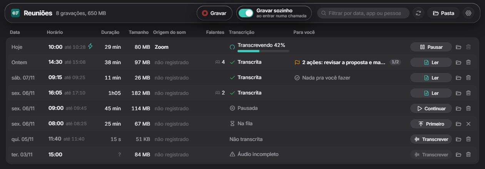
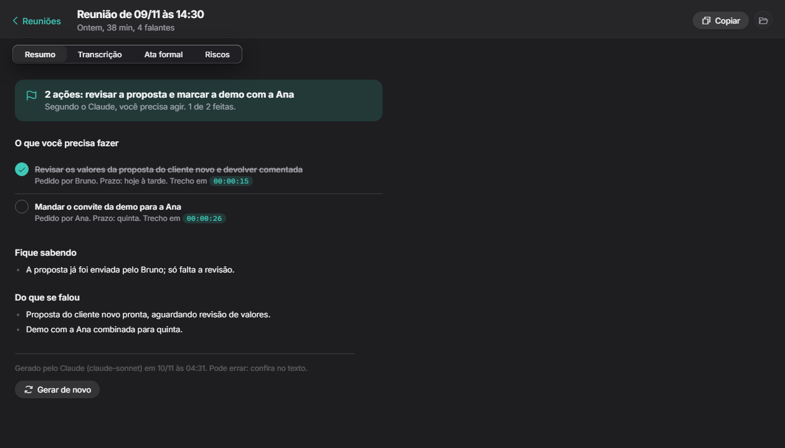
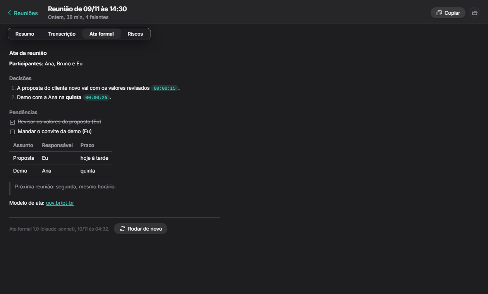
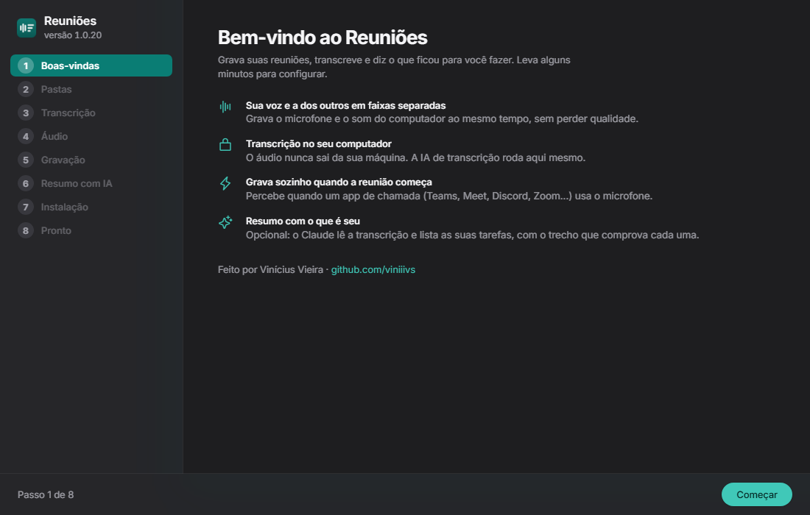

# Reuniões

Grava suas reuniões, transcreve no seu próprio computador e diz o que ficou para você fazer.

**[⬇ Baixar para Windows](https://github.com/viniiivs/reunioes/releases/latest/download/Reunioes-win-Setup.exe)** · versão 1.0.19 · Windows 10 e 11, 64 bits

**[🌐 Usar no navegador](https://viniiivs.github.io/reunioes/)** · sem instalar, no Chrome ou no Edge



## O que faz

- **Grava duas faixas separadas**: o seu microfone e o som do computador (a voz dos outros), sem perda de qualidade.
- **Grava automaticamente quando a reunião começa**: percebe quando um app de chamada (Teams, Meet, Discord, Zoom, Slack, Webex...) usa o microfone, e para quando a chamada acaba. Mutar o microfone não interrompe.
- **Atalho global** para gravar e parar, mesmo com o app fechado (padrão: Ctrl + Alt + G).
- **Transcreve no seu computador** com WhisperX. O áudio nunca sai da sua máquina. Com placa de vídeo NVIDIA, uma reunião de 30 minutos fica pronta em poucos minutos; sem ela, funciona pelo processador (mais devagar).
- **Se ajusta à sua placa de vídeo**: escolhe o modo de transcrição pela memória livre da placa, inclusive em placas de 6 GB com outros programas abertos. Se a memória acabar no meio, continua num modo mais leve (ou no processador) em vez de travar.
- **Mostra o andamento** da transcrição em porcentagem na lista. Dá para pausar e retomar sem perder o que já foi feito, passar uma reunião para o começo da fila e fechar o app no meio: a transcrição continua.
- **Separa as vozes** de cada pessoa (opcional) e aprende os nomes: dê nome a "Falante 1" uma vez e ele reconhece nas próximas reuniões.
- **Resumo com IA** (opcional, com o [Claude Code](https://claude.com/product/claude-code), na conta do Claude, ou com o [Codex](https://developers.openai.com/codex/cli), na conta do ChatGPT): lista as tarefas que são suas, com o trecho da reunião que comprova cada uma. Marque as tarefas como feitas e copie o resumo com um clique.
- **Addons**: cada pessoa pode instalar funções a mais, que aparecem como abas da reunião (ex.: ata, análise com IA, um script seu). Veja [Addons](#addons).
- **Atualiza automaticamente**: baixa versões novas em segundo plano e avisa quando é só reiniciar.





## Instalação

1. Baixe o **[Reunioes-win-Setup.exe](https://github.com/viniiivs/reunioes/releases/latest/download/Reunioes-win-Setup.exe)** e abra. Não precisa de administrador.
2. Na primeira vez o Windows pode mostrar **"O Windows protegeu o computador"** (o instalador não tem assinatura digital paga). Clique em **Mais informações** e depois em **Executar assim mesmo**.
3. Um assistente configura tudo: pastas, qualidade da transcrição, microfone e saída de som, gravação automática, e baixa o motor de transcrição.



### Do que precisa

| | |
|---|---|
| Sistema | Windows 10 ou 11, 64 bits |
| Espaço | de 3 GB (sem placa de vídeo, qualidade rápida) a 8 GB (placa NVIDIA, qualidade máxima), na pasta que você escolher |
| Internet | só para instalar e para as atualizações; gravar e transcrever funcionam offline |
| Placa de vídeo NVIDIA | opcional, deixa a transcrição muito mais rápida |
| Separar vozes | opcional; precisa de uma conta grátis no [Hugging Face](https://huggingface.co) e aceitar os termos do modelo [pyannote community-1](https://huggingface.co/pyannote/speaker-diarization-community-1). O assistente explica |
| Resumo com IA e addons de IA | opcionais; precisam do [Claude Code](https://claude.com/product/claude-code) (conta do Claude) ou do [Codex](https://developers.openai.com/codex/cli) (conta do ChatGPT, ex.: Plus) instalado e com login. Com os dois, escolha em Configurações › Resumo com IA |

## Versão web

Em **[viniiivs.github.io/reunioes](https://viniiivs.github.io/reunioes/)**, com as mesmas telas do app, sem instalar nada:

- **Grava duas faixas**: o seu microfone e o som da aba (ou da tela) da reunião que você compartilhar. Marque "Compartilhar áudio" quando o navegador perguntar.
- **Transcreve no navegador** com o Whisper ([Transformers.js](https://github.com/huggingface/transformers.js)), pela placa de vídeo (WebGPU) quando dá, ou pelo processador. O modelo é baixado uma vez (de 70 MB a 1,5 GB, conforme a qualidade) e o áudio não sai do computador.
- **Importa arquivos**: arraste um áudio ou vídeo para a lista.
- **Resumo com IA** (opcional) com a sua chave da API da Anthropic, guardada só no navegador. Addons só existem no app de Windows.
- Gravações e transcrições ficam no próprio navegador; baixe o que quiser guardar.
- Funciona offline depois do primeiro uso e pode ser instalada como app (ícone na barra de endereço).

O que só o app de Windows faz: gravar automaticamente quando a reunião começa, atalho global e separar as vozes de cada pessoa.

## Novidades

- **1.0.27** (10/11/2026): gravar pelo botão e fechar a janela não corta mais a gravação; teste de microfone e fone em Configurações › Áudio (nível ao vivo, gravar 5 s e ouvir de volta, som de teste); fone que cai no meio é reaberto sem parar a gravação.
- **1.0.26** (10/11/2026): desligar "Gravar automaticamente", ou tirar um app da lista, no meio de uma gravação automática faz ela não parar mais automaticamente: continua até você parar.
- **1.0.25** (10/11/2026): a gravação automática do Discord não se divide mais em um arquivo por fala: ela espera 3 minutos de silêncio, em vez de 45 segundos, antes de considerar que a chamada acabou.
- **1.0.24** (10/11/2026): resumo e addons também com o ChatGPT (Codex, conta Plus ou superior), escolha de em quais apps gravar automaticamente (ex.: deixar o Discord de fora) e o app acha o Claude Code instalado pelo npm ou winget sem reiniciar.
- **1.0.23** (10/11/2026): se a instalação do motor der erro durante a configuração, o app procura uma versão nova e oferece atualizar e continuar de onde parou.
- **1.0.22** (10/11/2026): a instalação não quebra mais ao baixar os modelos em PCs sem permissão para links simbólicos (erro 1314), e "Tentar de novo" mostra a etapa certa.
- **1.0.20** (10/11/2026): addons. Funções a mais que cada pessoa instala e que aparecem como abas da reunião, inclusive num trecho selecionado. O Fato ou fake saiu do app e virou um addon à parte; o Resumo continua embutido.
- **1.0.19** (26/10/2026): a transcrição não trava mais quando a placa de vídeo fica sem memória no meio do caminho; ela percebe e continua num modo mais leve, ou no processador.
- **1.0.18** (26/10/2026): transcrição muito mais rápida em placas com pouca memória livre; o app escolhe o modo que cabe na placa em vez de usar a memória do PC, que deixava tudo parado.
- **1.0.17** (24/10/2026): a porcentagem se atualiza automaticamente, fechar ou atualizar o app no meio não corta a transcrição, e o app não se atualiza durante uma.
- **1.0.16** (24/10/2026): o Fato ou fake confere todas as afirmações, no contexto da conversa e sempre com fonte, com filtro por veredito.

O app instalado se atualiza automaticamente. Histórico completo em [Releases](https://github.com/viniiivs/reunioes/releases).

## Addons

Addons fazem algo a mais com uma reunião já transcrita, cada um numa aba própria do leitor, ao lado do Resumo. O app não traz nenhum: cada pessoa instala os que quiser, e eles só existem no computador dela. Para instalar, use **Configurações › Addons › Instalar addon** e escolha a pasta do addon. Também dá para copiar a pasta para `%APPDATA%\Reunioes\addons\`. O interruptor de cada addon esconde ou mostra a aba dele.

Um addon é uma pasta (nome em minúsculas, números e hífen) com um `addon.json`. Ele pode ser de dois tipos.

**`claude`** (ou `ia`): manda a transcrição à IA com o prompt do addon: o Claude Code ou o Codex, a que estiver escolhida. A resposta vem em markdown.

```jsonc
{
  "nome": "Ata", "icone": "file-text", "descricao": "Ata formal da reunião.", "botao": "Gerar ata", "versao": "1.0",
  "tipo": "claude",
  "prompt": "prompt.md",          // prompt de sistema; {nome} vira o seu nome (Configurações › Resumo com IA)
  "modelo": "sonnet",             // sonnet, opus, haiku...; no Codex vira o esforço de raciocínio (médio, alto, baixo)
  "ferramentas": ["WebSearch"],   // opcional: WebSearch/WebFetch ligam a busca na web (nos dois)
  "ia": "claude",                 // opcional: só roda nesta IA ("claude" ou "codex")
  "prazoMinutos": 5
}
```

**`comando`**: roda um programa, que pode ser em qualquer linguagem.

```jsonc
{
  "nome": "Quem falou", "icone": "chart-bar", "botao": "Contar",
  "tipo": "comando",
  "comando": ["{python}", "falas.py"],   // {python} = o Python do motor do app; caminhos relativos à pasta do addon
  "prazoMinutos": 1
}
```

O programa funciona assim:
- **Entrada:** recebe a reunião em JSON pela entrada padrão, com os campos `base`, `data`, `nome`, `transcricao`, `pasta` e `prefixo` (o caminho dos arquivos da gravação sem a extensão).
- **Saída:** devolve markdown pela saída padrão.
- **Erros:** se o programa sair com código diferente de zero, as últimas linhas do stderr aparecem como erro na aba.

Com `"botaoTrecho": "Checar trecho"` no `addon.json`, o addon também roda num trecho: ao selecionar um texto na transcrição, aparece um botão com esse nome. Com isso:
- no tipo claude, a mensagem diz "Rode só neste trecho" e manda a transcrição só como contexto;
- no tipo comando, a entrada ganha o campo `trecho` (`texto`, `quem`, `tempo`);
- o resultado de cada trecho fica no topo da aba, acima do resultado da reunião.

O resultado é guardado junto da gravação, em `<gravação>.addon.<id>.json`. O markdown aceita:
- carimbos `[hh:mm:ss]`, que viram links para o trecho da transcrição;
- selos `[[ok: Fato]]`, `[[erro: Fake]]`, `[[alerta: Impreciso]]` e `[[neutro: Sem dados]]`;
- tabelas, listas de tarefas (`- [ ]`) e links `https`. O ícone é o nome de um [Phosphor Icon](https://phosphoricons.com).

Há dois exemplos em [`exemplos/addons`](exemplos/addons): `ata`, do tipo claude, e `falas`, do tipo comando.

## Privacidade

Gravação e transcrição acontecem no seu computador. Só sai daqui:
- o download dos modelos e das atualizações;
- o texto da transcrição, enviado à IA (Claude ou ChatGPT, pela sua conta), se você ligar o resumo com IA ou rodar um addon de IA (o addon pode deixar a IA pesquisar na web);
- o que um addon do tipo comando fizer: ele é um programa que você instalou.

Grave reuniões só com o conhecimento das pessoas e respeitando as leis do seu país.

## Desinstalar

Pelo Windows, em **Configurações > Aplicativos > Reuniões > Desinstalar**. O motor de transcrição e as configurações são apagados; **as gravações ficam** na pasta que você escolheu.

## Para desenvolvedores

```powershell
# compilar e rodar
dotnet run --project app

# gerar o instalador (build\releases) e publicar uma versão nova
.\build\publicar.ps1 -Versao 1.0.20 -Publicar

# montar a versão web (build\web) e publicar no GitHub Pages
.\build\web.ps1 -Publicar

# refazer os prints deste README (docs\*.png) com dados fictícios
py build\prints.py
```

O app é .NET 8 (WinForms + WebView2) com a interface em HTML/CSS/JS (`app/wwwroot`). O motor é Python (`app/motor`), instalado pelo próprio app com o [uv](https://github.com/astral-sh/uv). Instalador e atualizações: [Velopack](https://velopack.io). A versão web usa as mesmas telas com o motor em `web/` (IndexedDB, MediaRecorder e Whisper via Transformers.js). Comparação dos estilos visuais em `prototipos/` (`py prototipos\servir.py`).

## Créditos

Feito por **Vinícius Vieira** ([github.com/viniiivs](https://github.com/viniiivs)).

Usa [WhisperX](https://github.com/m-bain/whisperX), [faster-whisper](https://github.com/SYSTRAN/faster-whisper), [pyannote.audio](https://github.com/pyannote/pyannote-audio), [PyTorch](https://pytorch.org), [uv](https://github.com/astral-sh/uv), [Velopack](https://velopack.io), [NAudio](https://github.com/naudio/NAudio), [Phosphor Icons](https://phosphoricons.com) e a fonte [Inter](https://rsms.me/inter/).

Licença MIT.
