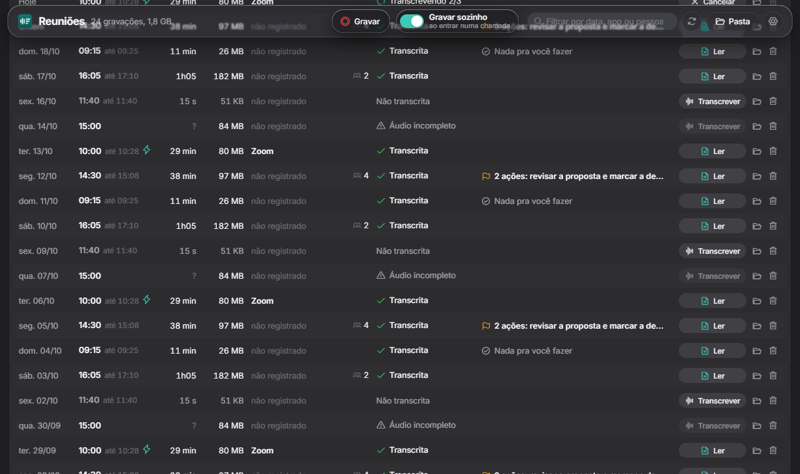
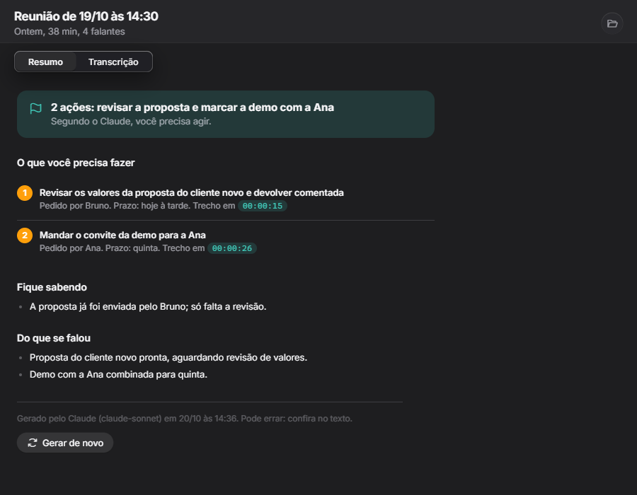
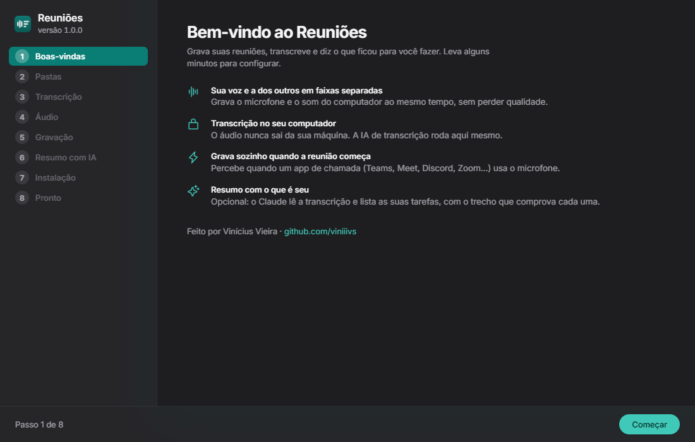

# Reuniões

Grava suas reuniões, transcreve no seu próprio computador e diz o que ficou para você fazer.

**[⬇ Baixar para Windows](https://github.com/viniiivs/reunioes/releases/latest/download/Reunioes-win-Setup.exe)** · Windows 10 e 11, 64 bits

**[🌐 Usar no navegador](https://viniiivs.github.io/reunioes/)** · sem instalar, no Chrome ou no Edge



## O que faz

- **Grava duas faixas separadas**: o seu microfone e o som do computador (a voz dos outros), sem perda de qualidade.
- **Grava sozinho quando a reunião começa**: percebe quando um app de chamada (Teams, Meet, Discord, Zoom, Slack, Webex...) usa o microfone, e para quando a chamada acaba. Mutar o microfone não interrompe.
- **Atalho global** para gravar e parar, mesmo com o app fechado (padrão: Ctrl + Alt + G).
- **Transcreve no seu computador** com WhisperX. O áudio nunca sai da sua máquina. Com placa de vídeo NVIDIA, uma reunião de 30 minutos fica pronta em poucos minutos; sem ela, funciona pelo processador (mais devagar).
- **Separa as vozes** de cada pessoa (opcional) e aprende os nomes: dê nome a "Falante 1" uma vez e ele reconhece nas próximas reuniões.
- **Resumo com IA** (opcional, com o [Claude Code](https://claude.com/product/claude-code)): lista as tarefas que são suas, com o trecho da reunião que comprova cada uma.
- **Atualiza sozinho**: baixa versões novas em segundo plano e avisa quando é só reiniciar.



## Instalação

1. Baixe o **[Reunioes-win-Setup.exe](https://github.com/viniiivs/reunioes/releases/latest/download/Reunioes-win-Setup.exe)** e abra. Não precisa de administrador.
2. Na primeira vez o Windows pode mostrar **"O Windows protegeu o computador"** (o instalador não tem assinatura digital paga). Clique em **Mais informações** e depois em **Executar assim mesmo**.
3. Um assistente configura tudo: pastas, qualidade da transcrição, microfone e saída de som, gravação automática, e baixa o motor de transcrição.



### Do que precisa

| | |
|---|---|
| Sistema | Windows 10 ou 11, 64 bits |
| Espaço | de 3 GB (sem placa de vídeo, qualidade rápida) a 8 GB (placa NVIDIA, qualidade máxima), na pasta que você escolher |
| Internet | só para instalar e para as atualizações; gravar e transcrever funcionam offline |
| Placa de vídeo NVIDIA | opcional, deixa a transcrição muito mais rápida |
| Separar vozes | opcional; precisa de uma conta grátis no [Hugging Face](https://huggingface.co) e aceitar os termos do modelo [pyannote community-1](https://huggingface.co/pyannote/speaker-diarization-community-1). O assistente explica |
| Resumo com IA | opcional; precisa do [Claude Code](https://claude.com/product/claude-code) instalado e com login |

## Versão web

Em **[viniiivs.github.io/reunioes](https://viniiivs.github.io/reunioes/)**, com as mesmas telas do app, sem instalar nada:

- **Grava duas faixas**: o seu microfone e o som da aba (ou da tela) da reunião que você compartilhar. Marque "Compartilhar áudio" quando o navegador perguntar.
- **Transcreve no navegador** com o Whisper ([Transformers.js](https://github.com/huggingface/transformers.js)), pela placa de vídeo (WebGPU) quando dá, ou pelo processador. O modelo é baixado uma vez (de 70 MB a 1,5 GB, conforme a qualidade) e o áudio não sai do computador.
- **Importa arquivos**: arraste um áudio ou vídeo para a lista.
- **Resumo com IA** (opcional) com a sua chave da API da Anthropic, guardada só no navegador.
- Gravações e transcrições ficam no próprio navegador; baixe o que quiser guardar.
- Funciona offline depois do primeiro uso e pode ser instalada como app (ícone na barra de endereço).

O que só o app de Windows faz: gravar sozinho quando a reunião começa, atalho global e separar as vozes de cada pessoa.
## Privacidade

Gravação e transcrição acontecem no seu computador. Só sai daqui:
- o download dos modelos e das atualizações;
- o texto da transcrição, enviado ao Claude, se você ligar o resumo com IA.

Grave reuniões só com o conhecimento das pessoas e respeitando as leis do seu país.

## Desinstalar

Pelo Windows, em **Configurações > Aplicativos > Reuniões > Desinstalar**. O motor de transcrição e as configurações são apagados; **as gravações ficam** na pasta que você escolheu.

## Para desenvolvedores

```powershell
# compilar e rodar
dotnet run --project app

# gerar o instalador (build\releases) e publicar uma versão nova
.\build\publicar.ps1 -Versao 1.0.7 -Publicar

# montar a versão web (build\web) e publicar no GitHub Pages
.\build\web.ps1 -Publicar
```

O app é .NET 8 (WinForms + WebView2) com a interface em HTML/CSS/JS (`app/wwwroot`). O motor é Python (`app/motor`), instalado pelo próprio app com o [uv](https://github.com/astral-sh/uv). Instalador e atualizações: [Velopack](https://velopack.io). A versão web usa as mesmas telas com o motor em `web/` (IndexedDB, MediaRecorder e Whisper via Transformers.js). Comparação dos estilos visuais em `prototipos/` (`py prototipos\servir.py`).

## Créditos

Feito por **Vinícius Vieira** ([github.com/viniiivs](https://github.com/viniiivs)).

Usa [WhisperX](https://github.com/m-bain/whisperX), [faster-whisper](https://github.com/SYSTRAN/faster-whisper), [pyannote.audio](https://github.com/pyannote/pyannote-audio), [PyTorch](https://pytorch.org), [uv](https://github.com/astral-sh/uv), [Velopack](https://velopack.io), [NAudio](https://github.com/naudio/NAudio), [Phosphor Icons](https://phosphoricons.com) e a fonte [Inter](https://rsms.me/inter/).

Licença MIT.
